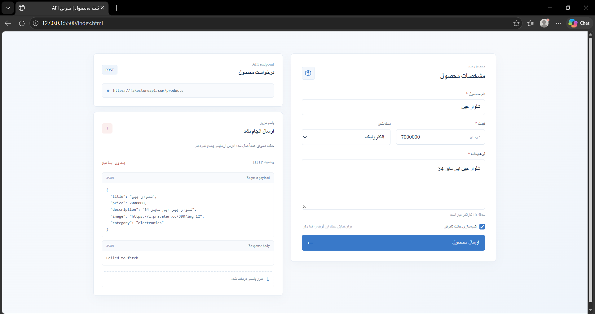

# ثبت محصول با API

یک فرم ساده برای ارسال محصول با درخواست `POST` به Fake Store API. قیمت به تومان است و فلش‌های ورودی آن هر بار ۱٬۰۰۰ تومان تغییر می‌کنند.

## اجرای پروژه

فایل `index.html` را باز کن. برای دیدن هدرها، payload و پاسخ، `F12` را بزن و در **Network → Fetch/XHR** درخواست را باز کن.

## نتیجه‌ها

### درخواست موفق

### حالت ناموفق

برای نمایش خطا، گزینه‌ی **شبیه‌سازی حالت ناموفق** را تیک بزن و فرم را ارسال کن. برای فرستادن درخواست واقعی به API، تیک را بردار.

Fake Store API برای تمرین است و محصول‌ها را به‌صورت دائمی ذخیره نمی‌کند.
