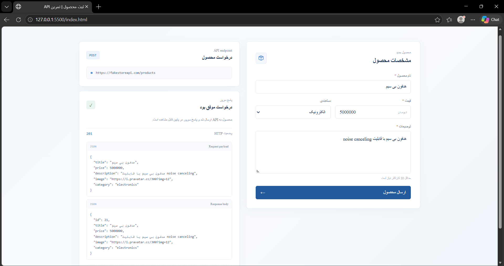

# ثبت محصول با API

تو این تسک، اطلاعات محصول رو تو فرم وارد می‌کنیم و با درخواست `POST` به Fake Store API می‌فرستیم.
بعد payload و پاسخ سرور رو بررسی می‌کنیم.
حالت ناموفق آزمایشی هست؛ برای نمایش خطا باید تیک «شبیه‌سازی حالت ناموفق» رو بزنیم.
Fake Store API صرفاً برای تمرینه و محصول‌ها رو به‌صورت دائمی ذخیره نمی‌کنه.

## تصاویر

### درخواست موفق

### حالت ناموفق

